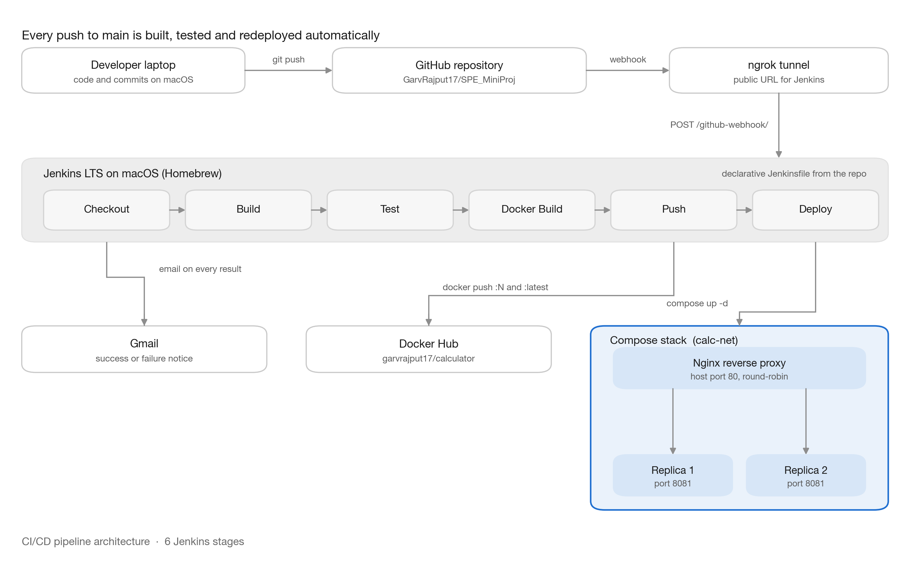

# CSE 816 — Software Production Engineering

## Mini-Project Report: End-to-End CI/CD Pipeline for a Calculator REST API

**Name:** Garv Rajput · **Roll No:** _[your roll no]_ · **Faculty:** Prof. B. Thangaraju

**Repository:** github.com/GarvRajput17/SPE_MiniProj · **Docker Hub:** hub.docker.com/r/garvrajput17/calculator

---

## 1. Goal

Build a Calculator REST API and wrap it in a fully automated CI/CD pipeline, so that a
single `git push` compiles the code, runs the tests, builds a Docker image, publishes it to
Docker Hub and redeploys the running stack — with no manual steps, and an email reporting
the result.

A change whose tests fail must be stopped before anything is published or deployed.

The API exposes `add`, `subtract`, `multiply` and `divide` under `/api/v1/`, plus an
Actuator health endpoint. Invalid input — division by zero, missing or non-numeric
parameters, `NaN`, `Infinity`, and results too large to represent — returns HTTP 400 with a
structured JSON error.

## 2. Tech stack

| Layer | Tool |
|---|---|
| Language / framework | Java 17, Spring Boot 3.2.5 (Spring Web, Actuator) |
| Build | Maven 3.9 → executable JAR |
| Testing | JUnit 5, Spring MockMvc, Surefire (JUnit XML) |
| Version control | Git, GitHub |
| CI/CD | Jenkins LTS 2.580.2, declarative `Jenkinsfile` |
| Containerisation | Docker 29.0, multi-stage build |
| Registry | Docker Hub — `garvrajput17/calculator` |
| Orchestration | Docker Compose v2.40 — 2 replicas + proxy |
| Reverse proxy | Nginx (alpine), round-robin on host port 80 |
| Webhook delivery | ngrok tunnel to the local Jenkins |
| Notifications | Gmail SMTP (app password held in Jenkins) |

## 3. Testing methodology

**27 tests** run on every build, in three layers:

| Layer | Count | What it covers |
|---|---|---|
| Unit — `CalculatorServiceTest` | 16 | The four operations, divide-by-zero, `NaN` / `Infinity` rejection, overflow, parameter parsing |
| Integration — `CalculatorControllerTest` | 10 | Real HTTP via MockMvc: status codes, JSON body shape, HTTP 400 error responses |
| Context — `CalculatorApplicationTests` | 1 | The Spring application context loads |

Surefire writes JUnit XML to `target/surefire-reports/`, which the `junit` step publishes to
Jenkins so results are visible per build — **including on failure**, since the report is
archived in a `post { always { ... } }` block.

The suite is the pipeline's gate: `mvn test` failing stops the build at the Test stage, so
Docker Build, Push and Deploy never run.

```{=openxml}
<w:p><w:r><w:br w:type="page"/></w:r></w:p>
```

## 4. Pipeline architecture



### 4.1 Trigger

A `git push` to `main` is the only manual action. GitHub sends a webhook to Jenkins the
moment the push lands. Because Jenkins runs on a laptop with no public address, GitHub
cannot reach it directly — an **ngrok** tunnel provides a public HTTPS URL that forwards to
the local Jenkins, and the webhook posts to `/github-webhook/` on that address.

A **two-minute SCM poll** is configured as a fallback, so the project still builds
automatically whenever the tunnel is down. The webhook gives near-instant builds; the poll
guarantees the build happens at all.

### 4.2 Controller

Jenkins reads the pipeline from the `Jenkinsfile` in the repository, so the pipeline is
versioned alongside the code it builds, and the six stages run in order on the triggering
commit. Only **one build runs at a time** — two builds reconciling the same Compose stack
would collide over container names and host port 80.

### 4.3 Quality gate

The Test stage decides whether the commit goes any further. If `mvn test` fails, the build
stops there: no image is built, nothing is pushed to Docker Hub, and the running deployment
is left untouched on its previous image.

### 4.4 Publication

Once the tests pass, the image is built and pushed to Docker Hub under two tags — the build
number and `:latest`. The build number tag makes every deployment traceable to the exact
commit that produced it. Credentials come from the Jenkins credential store and are masked
in the console log.

### 4.5 Deployment

The Deploy stage runs `docker compose up -d` against the same named stack, so it reconciles
the deployment in place and recreates only the containers whose image changed. Nginx is then
reloaded and the live API is smoke-tested through the proxy before the build is called
successful.

Users reach only Nginx on host port 80. Both application replicas sit on the private
`calc-net` network with no host port of their own, so the proxy is the single entry point.

### 4.6 Feedback

Jenkins emails the outcome of every run, success or failure, through Gmail — so a broken
build is noticed without anyone watching the dashboard.

## 5. Pipeline stages

| Stage | What it does |
|---|---|
| **Checkout** | `checkout scm` fetches the triggering commit and logs its hash and subject. |
| **Build** | `mvn -B clean package -DskipTests` produces the executable JAR. |
| **Test** | `mvn -B test` runs the 27 tests; `junit` publishes the XML even on failure, and a failure stops the pipeline. |
| **Docker Build** | Builds the two-stage image, tagged `garvrajput17/calculator:<build>` and `:latest`. |
| **Push** | `withCredentials(dockerhub-creds)` → `docker login --password-stdin`, pushes both tags, `docker logout`. The token is masked in the log. |
| **Deploy** | `IMAGE_TAG=<build> docker compose up -d --no-build`, waits for every container to report healthy, reloads Nginx, then smoke-tests the live API through the proxy. |

Deploy verifies more than "the containers started": it calls the real endpoints through
Nginx, asserts that divide-by-zero still returns HTTP 400, and confirms **both** replicas
appear as distinct upstreams in the Nginx log — so a deploy that silently loses a replica
fails the build.

**The gate, demonstrated.** `subtract` was deliberately changed to return `a + b` and
pushed. Build **#5** failed at Test — 3 tests caught it, the later stages never ran, no image
tag was published, the running stack kept serving the previous image, and the failure email
arrived. Reverting produced a green build (Figures 2 and 3).

```{=openxml}
<w:p><w:r><w:br w:type="page"/></w:r></w:p>
```

## 6. Docker and Compose design

The image is built in **two stages**. The first runs Maven to compile the JAR; `pom.xml` is
copied before the source, so the cached dependency layer is reused until dependencies
change. The second keeps only a JRE and the JAR — no Maven, no source — runs as a non-root
user, and is **221 MB on disk / 66 MB compressed**. The JVM is started with `exec` so it
becomes PID 1 and shuts down cleanly on a stop signal.

Compose runs two replicas and Nginx on a private network. Every container has a health
check and a restart policy, and Nginx starts only after both replicas are healthy.

Re-runs are safe: the stack keeps the same project name, so `docker compose up -d`
reconciles it in place and recreates only containers whose image changed.

## 7. Challenges faced

**1. The runtime base image did not exist for this machine.** `eclipse-temurin:17-jre-alpine` is published for Intel only, so the Docker build failed on an Apple Silicon Mac with *no match for platform in manifest*.

*Resolution:* switched the runtime stage to `bellsoft/liberica-openjre-alpine:17` — multi-architecture, and the same size.

**2. Nginx returned 502 after every redeploy.** Recreated containers get new IP addresses, but Nginx resolves its upstreams once at worker startup and caches them, so it kept forwarding to containers that no longer existed.

*Resolution:* the Deploy stage now runs `nginx -s reload` once the replicas are healthy, which re-resolves the addresses without dropping in-flight connections.

**3. The health gate passed while the proxy was broken.** Each container's health check only probes itself, so nothing exercised the Nginx → app path, and Nginx's own check was still reporting the `healthy` it had earned before the restart.

*Resolution:* added a smoke test that calls the API *through* Nginx and asserts both replicas are serving traffic.

**4. Jenkins could not find Maven or Docker.** Its background service starts with a minimal `PATH` that excludes Homebrew, and Maven additionally refused to start with no `JAVA_HOME` set.

*Resolution:* set `PATH` and `JAVA_HOME` (JDK 17) as Jenkins global environment variables, keeping machine-specific paths out of the `Jenkinsfile`.

**5. Jenkins had no login, but was about to be exposed publicly.** Harmless while it listened only on the laptop — but an open Jenkins on a public URL lets anyone run commands on the machine.

*Resolution:* enabled a login before opening the tunnel. The webhook endpoint still accepts GitHub's unauthenticated POSTs by design, so automatic builds kept working.

**6. Docker Hub rejected the account password,** so the Push stage could not authenticate.

*Resolution:* generated a read/write access token and stored it in the Jenkins credential store, piped to `docker login --password-stdin` so it never appears in the log or process list.

```{=openxml}
<w:p><w:r><w:br w:type="page"/></w:r></w:p>
```

## Appendix: screenshots

**Figure 1.** Jenkins stage view — build #7 green across all six stages.

**Figure 2.** Build #5 red at Test, with Docker Build, Push and Deploy skipped.

**Figure 3.** Build notification emails — success and failure.

**Figure 4.** `docker compose ps` — two replicas and Nginx, all healthy; only Nginx publishes a host port.

**Figure 5.** Nginx log — requests alternating between the two replicas.

**Figure 6.** API responses through Nginx — the four operations, the HTTP 400 errors, and health `UP`.

**Figure 7.** Docker Hub repository page — the published tags.
